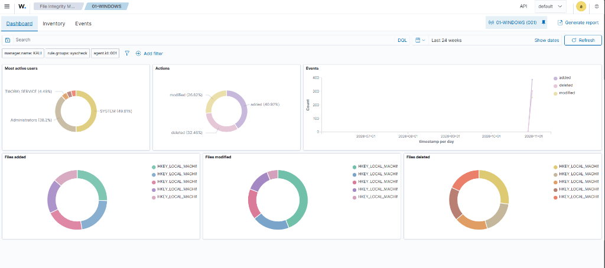
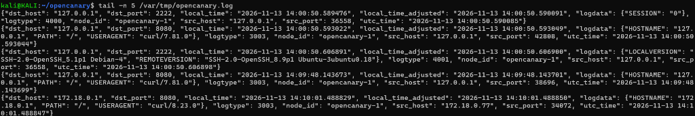
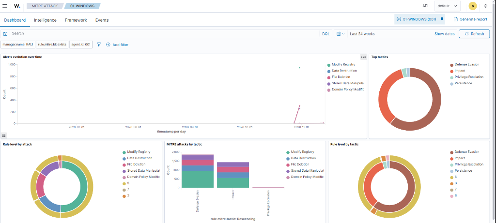
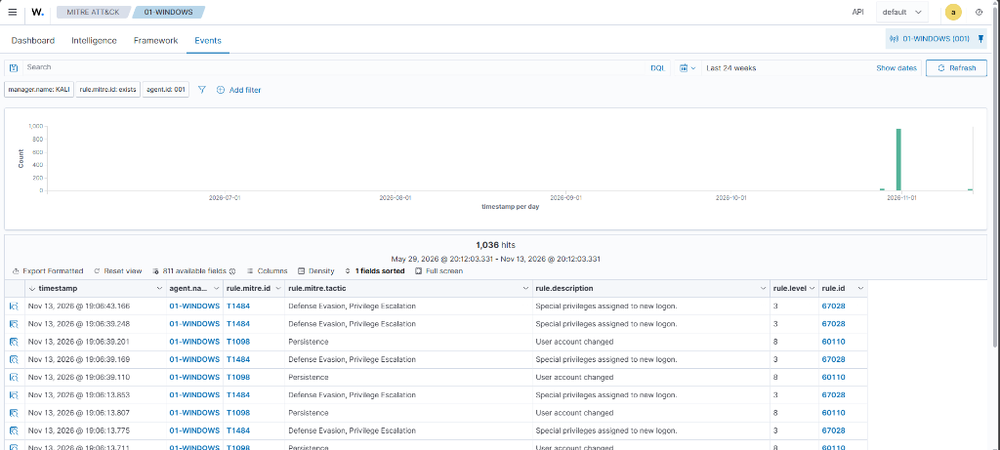
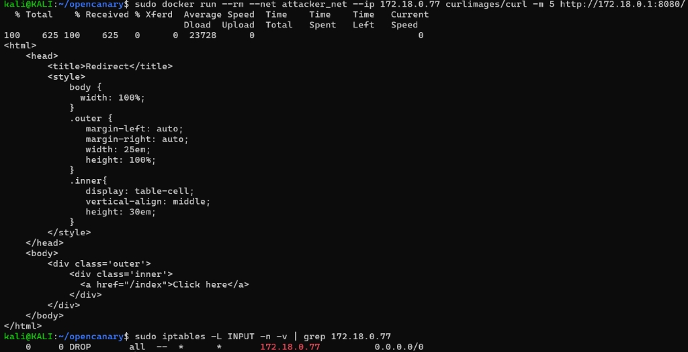

# 🛡️ Wazuh SIEM + OpenCanary Deception Lab


---

## 📋 Executive Summary

> **Why does this project matter in a real SOC?**

Traditional SIEMs suffer from **alert fatigue and high false-positive rates** because they correlate noisy, real-system telemetry. This lab solves that by integrating a **Deception Honeypot (OpenCanary)** that emulates high-value services (SSH, FTP, HTTP) which no legitimate user should ever touch. The result: **every single alert is a confirmed threat with zero false positives**.

This architecture goes beyond detection. When a honeypot alert fires, Wazuh's **Active Response engine automatically issues cross-platform IP blocks** — via `iptables` on the Linux SIEM host *and* via `netsh` on a monitored Windows agent — achieving **zero-touch, automated XDR containment** in under 60 seconds, before an analyst even opens the dashboard.

### 🏆 Core Competencies Demonstrated

| Domain | Skill |
|--------|-------|
| **SIEM Architecture** | Wazuh Manager deployment, multi-agent enrollment (Linux + Windows) |
| **Custom Decoder Engineering** | XML decoder authoring — mapping `src_host` → `srcip` for Active Response compatibility |
| **Custom Rule Engineering** | Multi-tier rule hierarchy with parent/child correlation (IDs 100200–100203) |
| **Deception Engineering** | OpenCanary honeypot deployment via Docker with fake FTP, SSH, and HTTP services |
| **MITRE ATT&CK Mapping** | T1110, T1021.004, T1021.002, T1046, T1190 mapped directly in rule XML |
| **Automated Active Response (XDR)** | Zero-touch IP blocking via `firewall-drop` (iptables) and `netsh` (Windows Firewall) |
| **File Integrity Monitoring (FIM)** | Real-time syscheck on `/etc`, `/usr/bin`, `/boot` with dashboard correlation |
| **Adversary Simulation (Purple Team)** | Containerized attack scripts simulating real TTPs from isolated network namespaces |

---

## 🗺️ Complete End-to-End Project Mind Map & Flowchart Architecture

```text
================================================================================
          COMPLETE END-TO-END PROJECT MIND MAP & FLOWCHART ARCHITECTURE
================================================================================

1. INFRASTRUCTURE & AGENT SETUP (WSL2 Ubuntu & Windows Host)
   ├── [WSL2 Ubuntu: kali@KALI] ── Install & Initialize Wazuh Manager (v4.14.9)
   └── [Windows Host] ─────────── Install & Register Wazuh Windows Agent (Agent ID: 001)

2. FILE INTEGRITY MONITORING (FIM / SYSCHECK)
   ├── Configure <syscheck> in ossec.conf to watch critical directories (/etc, /usr/bin, /boot)
   └── Verify real-time file changes, additions, and deletions on the Wazuh Dashboard (FIM module)

3. OPENCANARY HONEYPOT DEPLOYMENT (Docker)
   ├── Clone Repository & Prep Log: git clone thinkst/opencanary + touch /var/tmp/opencanary.log
   ├── Configure Services (.opencanary.conf): Enable Fake FTP (2121), SSH (2222), & HTTP (8080)
   ├── Configure Docker Compose (docker-compose.yml): Use network_mode: "host" & attacker_net bridge
   └── Launch Container: sudo docker compose up -d

4. WAZUH LOG INGESTION & DECODER CONFIGURATION
   ├── Add <localfile> block in ossec.conf pointing to /var/tmp/opencanary.log (JSON format)
   └── Create custom decoder (local_decoder.xml) using JSON_Decoder to map src_host -> srcip

5. CUSTOM RULES & MITRE ATT&CK MAPPING
   ├── Create base parent rule (ID: 100200) to match OpenCanary logs
   └── Create High-Severity Rules (Level 12) mapped to MITRE ATT&CK:
       ├── Rule 100201 [Fake SSH]: Brute-force / Login attempt ──> T1110, T1021.004
       ├── Rule 100202 [Fake FTP/SMB]: Probing & Enumeration ──> T1021.002, T1046
       └── Rule 100203 [Fake HTTP]: Web App Scan / Recon ─────> T1190

6. AUTOMATED ACTIVE RESPONSE (ZERO-TOUCH IP BLOCKING)
   ├── Configure Whitelist (<white_list> in ossec.conf for localhost, ::1, and WSL host IP)
   ├── Configure Active Response 1: Local firewall-drop via iptables on WSL Ubuntu host
   └── Configure Active Response 2: Remote netsh via Windows Firewall on WINDOWS-AGENT (001)

7. ATTACK SIMULATION & DASHBOARD VERIFICATION
   ├── Test rules using Wazuh log parser simulator (wazuh-logtest)
   ├── Launch real-time container attacks from isolated IPs (172.18.0.97 - .99) targeting honeypot ports
   └── Verify Live Defense & GUI Analytics:
       ├── Check active response execution logs (active-responses.log, iptables, and Windows Firewall)
       └── Confirm high-severity alerts, source IPs, and MITRE ATT&CK T-codes on Wazuh Dashboard UI
================================================================================
```

---

## 🔧 Detailed Step-by-Step Technical Breakdown

### Phase 1 — Infrastructure & Agent Setup

Deploy the Wazuh Manager on WSL2 Ubuntu and enroll the Windows host as Agent `001`.

```bash
# Install Wazuh Manager on WSL2 Ubuntu (kali@KALI)
curl -sO https://packages.wazuh.com/4.x/wazuh-install.sh
sudo bash wazuh-install.sh -a

# Verify manager is running
sudo systemctl status wazuh-manager
```

**Engineering Decision:** Running Wazuh Manager inside WSL2 keeps the entire SIEM stack on a single machine while still allowing real Windows telemetry from the host OS — no extra VM overhead required.

---

### Phase 2 — File Integrity Monitoring (FIM / Syscheck)

Configure `syscheck` in `ossec.conf` to monitor critical Linux directories in real time.

```xml
<!-- From: configs/ossec_config_snippet.xml -->
<syscheck>
  <disabled>no</disabled>
  <directories check_all="yes" realtime="yes">/etc,/usr/bin,/boot</directories>
</syscheck>
```

**Verification:**
```bash
# Trigger a FIM event
sudo touch /etc/testfile_fim.txt
# Confirm alert appears on Wazuh Dashboard → Integrity Monitoring module
sudo rm /etc/testfile_fim.txt
```

**Engineering Decision:** `realtime="yes"` uses Linux `inotify` to send alerts within seconds of a file change — far superior to the default polling mode which can delay detection by minutes.

#### Wazuh FIM Dashboard — Windows Agent (001)


*Wazuh Dashboard showing File Integrity Monitoring for `01-WINDOWS (001)` — Most Active Users breakdown (SYSTEM 49.81%, Administrators 38.2%), Actions distribution (added 40.97%, deleted 32.45%, modified 26.62%), and Events timeline with files added, modified, and deleted across HKEY_LOCAL_MACHINE registry paths.*

---

### Phase 3 — OpenCanary Honeypot Deployment (Docker)

Deploy OpenCanary as a Dockerized honeypot exposing fake services that no real user should touch.

```bash
# Prepare the shared log file (must exist before Docker bind-mounts it)
sudo touch /var/tmp/opencanary.log
sudo chmod 666 /var/tmp/opencanary.log

# Launch the honeypot
sudo docker compose up -d

# Verify it's listening on decoy ports
sudo ss -tlnp | grep -E '2121|2222|8080'
```

**Engineering Decision:** `network_mode: "host"` is critical. It makes OpenCanary bind directly to the **host network stack** instead of Docker's NAT layer. This means when Wazuh issues a `firewall-drop` via `iptables`, the block applies at the host perimeter and genuinely stops traffic — not just inside the Docker bridge.

#### OpenCanary Live JSON Telemetry


*Terminal output of `tail -n 5 /var/tmp/opencanary.log` showing live OpenCanary JSON events — SSH sessions (`logtype: 4000`, `4001`) on port 2222, HTTP requests (`logtype: 3003`) on port 8080 with `USERAGENT: curl/7.81.0`, and attacker source IPs (`127.0.0.1`, `172.18.0.77`) with full timestamp and hostname metadata.*

---

### Phase 4 — Wazuh Log Ingestion & Custom Decoder

Instruct Wazuh to ingest OpenCanary's JSON logs and decode them correctly.

```xml
<!-- localfile block in ossec.conf -->
<localfile>
  <log_format>json</log_format>
  <location>/var/tmp/opencanary.log</location>
</localfile>
```

**Custom Decoder (`configs/local_decoder.xml`):**
```xml
<decoder name="json-opencanary">
  <parent>json</parent>
  <prematch>"node_id":\s*"opencanary-1"</prematch>
  <plugin_decoder>JSON_Decoder</plugin_decoder>
</decoder>

<decoder name="json-opencanary">
  <parent>json</parent>
  <regex>"src_host":\s*"(\d+.\d+.\d+.\d+)"</regex>
  <order>srcip</order>
</decoder>
```

**Engineering Decision:** Wazuh's Active Response engine looks for a decoded `srcip` field to know which IP to block. OpenCanary uses `src_host` instead of `srcip`. The second decoder stage explicitly remaps `src_host` → `srcip`, which is what makes automated IP blocking work at all.

---

### Phase 5 — Custom Rules & MITRE ATT&CK Mapping

Build a rule hierarchy where a parent rule (level 10) catches all OpenCanary events, and child rules (level 12) classify each attack type with MITRE ATT&CK technique IDs.

```xml
<!-- Parent rule — base catch for all honeypot activity -->
<rule id="100200" level="10">
  <decoded_as>json</decoded_as>
  <field name="node_id">opencanary-1</field>
  <description>OpenCanary Honeypot: Suspicious interaction detected from $(src_host)</description>
</rule>

<!-- Child rules inherit from 100200 and add MITRE context -->
<rule id="100201" level="12">
  <if_sid>100200</if_sid>
  <field name="logtype">^4000$|^4001$|^4002$</field>
  <description>OpenCanary [Fake SSH]: Brute-force from $(src_host) on port $(dst_port)</description>
  <mitre>
    <id>T1110</id>      <!-- Brute Force -->
    <id>T1021.004</id>  <!-- Remote Services: SSH -->
  </mitre>
</rule>
```

**Test rules without live traffic:**
```bash
# Use Wazuh's built-in log simulator
sudo /var/ossec/bin/wazuh-logtest
# Then paste a sample OpenCanary JSON event and verify rule 100201 fires
```

#### MITRE ATT&CK Dashboard — Tactics & Attack Distribution


*Wazuh MITRE ATT&CK module for `01-WINDOWS (001)` — Alerts Evolution timeline, Top Tactics pie chart (Defense Evasion, Impact, Privilege Escalation, Persistence), MITRE Attacks by Tactic bar chart, and Rule Level by Attack/Tactic breakdowns across 1,036 detected events.*

#### MITRE ATT&CK Events — Technique-Level Detail


*Wazuh MITRE ATT&CK Events view showing 1,036 hits — individual event rows with timestamps, agent name (`01-WINDOWS`), MITRE technique IDs (`T1484`, `T1098`), mapped tactics (Defense Evasion, Privilege Escalation, Persistence), rule descriptions, severity levels, and corresponding Wazuh rule IDs (`67028`, `60110`).*

---

### Phase 6 — Automated Active Response (Zero-Touch XDR)

Configure dual active response: one for the Linux SIEM host, one for the enrolled Windows agent.

```xml
<!-- AR 1: Block on Linux via iptables (immediate, local) -->
<active-response>
  <command>firewall-drop</command>
  <location>local</location>
  <rules_id>100201,100202,100203</rules_id>
  <timeout>600</timeout>  <!-- 10-minute auto-expiry -->
</active-response>

<!-- AR 2: Block on Windows Agent 001 via netsh -->
<active-response>
  <command>netsh</command>
  <location>defined-agent</location>
  <agent_id>001</agent_id>
  <rules_id>100201,100202,100203</rules_id>
  <timeout>600</timeout>
</active-response>
```

**Verify blocks after an attack:**
```bash
# Linux — confirm iptables block rule
sudo iptables -L INPUT -n -v | grep DROP

# Linux — check the AR execution log
sudo tail -f /var/ossec/logs/active-responses.log

# Windows — confirm netsh firewall rule (run on Windows host)
netsh advfirewall firewall show rule name=all | findstr "Wazuh"
```

**Engineering Decision:** The 600-second `<timeout>` auto-expires the block, preventing accidental permanent lockouts from misconfigured scanners. The `<white_list>` entries in `ossec.conf` ensure the WSL host bridge IP (`172.26.128.1`) is never blocked, preventing the SIEM from cutting off its own management channel.

---

### Phase 7 — Attack Simulation & Dashboard Verification

Launch containerized attacks from isolated network namespaces to simulate real adversary TTPs.

```bash
# Run the full Purple Team simulation
chmod +x scripts/attack_simulation.sh
sudo ./scripts/attack_simulation.sh
```

**What to verify on the Wazuh Dashboard:**
1. **Security Events** → Filter by Rule Group `opencanary` → Confirm rules 100201–100203 firing
2. **MITRE ATT&CK** → Verify techniques T1110, T1021.004, T1046, T1190 are highlighted
3. **Active Response** → Check `active-responses.log` for `firewall-drop` execution entries
4. **Agents** → Confirm `01-WINDOWS (001)` shows as Active and received the netsh block command

#### Active Response — Automated IP Block via `iptables`


*Live proof of zero-touch containment: Docker container executes a curl request from attacker IP `172.18.0.77` against the OpenCanary HTTP decoy on port 8080, OpenCanary captures the request and Wazuh fires rule 100203 (Fake HTTP), triggering `firewall-drop` — the subsequent `sudo iptables -L INPUT -n -v | grep 172.18.0.77` confirms the attacker IP is now blocked with a `DROP` rule in the INPUT chain.*

---

## 📸 Visual Evidence

| # | Screenshot | Description |
|---|-----------|-------------|
| 1 | [FIM Dashboard](./screenshots/01-wazuh-fim-dashboard.png) | File Integrity Monitoring — Windows Agent `001` with add/modify/delete breakdown |
| 2 | [OpenCanary Logs](./screenshots/02-opencanary-logs.png) | Live JSON telemetry from OpenCanary honeypot services |
| 3 | [MITRE Dashboard](./screenshots/03-mitre-attack-dashboard.png) | MITRE ATT&CK tactic distribution and alert evolution |
| 4 | [MITRE Events](./screenshots/04-mitre-attack-events.png) | MITRE technique-level event detail (T1484, T1098) |
| 5 | [Active Response](./screenshots/05-active-response-block.png) | Automated `iptables DROP` rule triggered by honeypot alert |

---

## 📁 Repository Structure

```text
Wazuh-SIEM-OpenCanary-Deception-Lab/
├── README.md
├── configs/
│   ├── opencanary.conf           # OpenCanary honeypot service configuration
│   ├── docker-compose.yml        # Docker deployment with host networking + attacker_net bridge
│   ├── local_decoder.xml         # Custom Wazuh XML decoder (src_host → srcip mapping)
│   ├── local_rules.xml           # Custom Wazuh rules (100200–100203) with MITRE ATT&CK tags
│   └── ossec_config_snippet.xml  # ossec.conf additions: FIM, localfile ingestion, Active Response
└── scripts/
    ├── wazuh_service_control.sh  # Start/stop Wazuh Manager & Dashboard
    └── attack_simulation.sh      # Purple Team containerized TTP simulation script
```

---

## 🚀 Quick Start

```bash
# 1. Clone this repo
git clone https://github.com/dev1hardik/Wazuh-SIEM-OpenCanary-Deception-Lab.git
cd Wazuh-SIEM-OpenCanary-Deception-Lab

# 2. Deploy OpenCanary honeypot
sudo touch /var/tmp/opencanary.log && sudo chmod 666 /var/tmp/opencanary.log
mkdir -p configs/data
cp configs/opencanary.conf configs/data/.opencanary.conf
sudo docker compose -f configs/docker-compose.yml up -d

# 3. Apply Wazuh configurations (copy to Wazuh config directory)
sudo cp configs/local_decoder.xml /var/ossec/etc/decoders/
sudo cp configs/local_rules.xml /var/ossec/etc/rules/
# Merge ossec_config_snippet.xml entries into /var/ossec/etc/ossec.conf

# 4. Restart Wazuh Manager to apply changes
sudo systemctl restart wazuh-manager

# 5. Run attack simulation
chmod +x scripts/attack_simulation.sh
sudo ./scripts/attack_simulation.sh
```

---

## 🔗 References & Technologies

| Technology | Purpose | Version |
|------------|---------|---------|
| [Wazuh](https://wazuh.com) | SIEM & XDR Platform | v4.14.9 |
| [OpenCanary](https://github.com/thinkst/opencanary) | Honeypot Deception Framework | Latest |
| [Docker](https://docker.com) | Container Runtime | 24.x+ |
| [MITRE ATT&CK](https://attack.mitre.org) | Adversarial Tactics Framework | v14 |
| WSL2 Ubuntu | SIEM Host Environment | Ubuntu 22.04 |

---

*Production-grade cybersecurity portfolio project demonstrating enterprise SIEM engineering, deception technology, and automated threat containment.*
